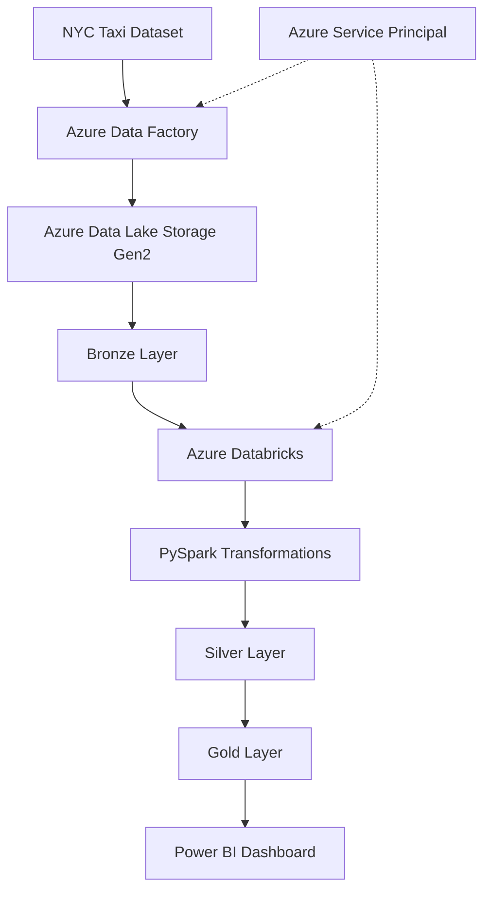

# Azure Data Engineering Pipeline – NYC Taxi Analytics

An end-to-end Azure Data Engineering project that implements a **Bronze–Silver–Gold Medallion Architecture** to ingest, transform, and analyze NYC Taxi data. The pipeline leverages Azure Data Factory, Azure Data Lake Storage Gen2, Azure Databricks, and PySpark to build structured analytical datasets, which are subsequently used for business intelligence and visualization through Power BI.

## Project Overview

This project demonstrates the implementation of a cloud-based data engineering pipeline using Microsoft Azure services. It processes over **1 million records** through a multi-layered data architecture, transforming raw data into structured, analytics-ready datasets.

The solution follows the Medallion Architecture to organize data into three progressive layers:

- **Bronze:** Stores ingested raw data in its original form.
- **Silver:** Processes and cleans raw data using PySpark to improve data quality and consistency.
- **Gold:** Contains refined, structured datasets prepared for analytical queries and Power BI reporting.

## Architecture

## Technology Stack

| Category | Technologies |
|---|---|
| Cloud Platform | Microsoft Azure |
| Data Orchestration | Azure Data Factory (ADF) |
| Cloud Storage | Azure Data Lake Storage Gen2 |
| Data Processing | Azure Databricks, PySpark |
| Architecture | Medallion Architecture (Bronze–Silver–Gold) |
| Authentication | Azure Service Principal |
| Visualization | Microsoft Power BI |

## Pipeline Workflow

### 1. Data Ingestion – Azure Data Factory

- Configured Azure Data Factory pipelines to orchestrate data ingestion.
- Ingested NYC Taxi dataset records into Azure Data Lake Storage Gen2.
- Organized ingested data within the Bronze layer for subsequent processing.

### 2. Bronze Layer – Raw Data Storage

- Maintained the ingested source data in its raw format.
- Established the initial storage layer for downstream transformations.
- Preserved the separation between raw and processed datasets.

### 3. Silver Layer – Data Transformation

- Used Azure Databricks and PySpark to process the ingested datasets.
- Performed data transformations and preparation to improve data consistency.
- Created structured datasets for downstream analytical processing.

### 4. Gold Layer – Analytics-Ready Data

- Developed the Gold layer containing refined datasets for analytical consumption.
- Prepared processed data for reporting and visualization.
- Established the final data layer consumed by Power BI.

### 5. Dashboard Development – Power BI

- Connected Power BI to the processed analytical data.
- Developed dashboards to visualize NYC Taxi analytics.
- Presented insights through interactive business intelligence reports.

## Security and Authentication

Implemented Azure Service Principal-based authentication to facilitate secure access between the Azure services involved in the pipeline.

This provided an identity-based authentication mechanism for accessing the required Azure resources.

## Key Project Highlights

- Implemented an end-to-end cloud data engineering pipeline using Microsoft Azure.
- Processed **1M+ records** through a structured Medallion Architecture.
- Integrated Azure Data Factory, ADLS Gen2, and Azure Databricks.
- Used PySpark for large-scale data transformation and processing.
- Implemented Service Principal-based authentication.
- Delivered Power BI dashboards using Gold-layer analytical datasets.

## Architecture Design

The project follows a layered data processing approach:

| Layer | Purpose |
|---|---|
| Bronze | Raw data ingestion and storage |
| Silver | Data cleaning and transformation |
| Gold | Analytics-ready data for reporting |

This separation improves data organization and supports a structured approach to data processing and analytical consumption.

## Project Status

**Implementation: Completed**

The complete pipeline, including the Bronze, Silver, and Gold layers and Power BI dashboard, was implemented and tested in the Azure environment.

The original Azure subscription was subsequently disabled following the expiration of its free credits. Consequently, the deployed Azure resources are no longer active, and the original cloud environment is not currently accessible.

This repository documents the architecture, implementation, and technologies used in the completed project. It does not represent a currently running Azure deployment.

## Skills Demonstrated

- Cloud Data Engineering
- ETL Pipeline Development
- Data Ingestion and Orchestration
- Medallion Architecture
- Distributed Data Processing
- PySpark Transformations
- Azure Cloud Services
- Secure Cloud Authentication
- Business Intelligence and Data Visualization

---

**Note:** This project was developed as a hands-on implementation to gain practical experience with Azure-based data engineering workflows and cloud analytics.
